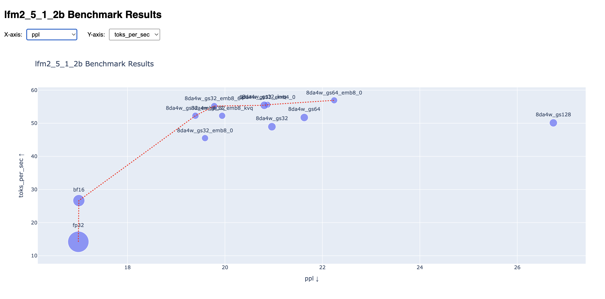

# LLM Quantization Benchmark Utilities

This directory contains utilities for benchmarking quantized LLM inference
across different backends and configurations to make informed decisions about
which quantization strategy to use in order to minimize performance degradation.

## How to Use

### Prerequisites

**ExecuTorch** must be installed from source inside its own virtualenv:

```bash
# Inside the ExecuTorch source tree:
./install_executorch.sh   
```

The script expects a `.venv` at `<executorch-dir>/.venv` and will invoke
`<executorch-dir>/.venv/bin/python` directly to run exports.

### Setup

Install benchmark dependencies (uses [`uv`](https://docs.astral.sh/uv/)):

```bash
uv sync
```

### Run the benchmark

The script iterates over all quantization configs defined in
`quantization_overrides`, exports each to a `.pte` file, runs the benchmarks
defined in `benchmarks`, saves results to
`<output-dir>/<model-class>_results.csv`, and writes an interactive HTML plot to
`<output-dir>/<model-class>_results.html`.

Example usage:

```bash
uv run llm_export_benchmark.py \
  --executorch-dir /path/to/executorch \
  --config-yaml examples/models/lfm2/config/lfm2_xnnpack_q8da4w.yaml \
  --model-class lfm2_5_1_2b \
  --model-params examples/models/lfm2/config/lfm2_5_1_2b_config.json \
  --tokenizer liquid-ai/lfm2-1.2b \
  --max-seq-length 2048 \
  --max-context-length 2048
```

> **Path resolution:** `--config-yaml` and `--model-params` may be given as
> paths relative to `--executorch-dir`, or as absolute paths.

#### `--config-yaml`

A Hydra YAML file that sets the base export configuration. The script merges
this with per-variant overrides at runtime. Example configs for each model live
in `examples/models/<model>/config/` inside the ExecuTorch repo, e.g.:

```text
examples/models/lfm2/config/lfm2_xnnpack_q8da4w.yaml
examples/models/llama/config/llama_xnnpack.yaml
examples/models/qwen2_5/config/qwen2_5_xnnpack_q8da4w.yaml
```

A minimal example config for XNNPACK export looks like this:

```yaml
base:
  # BOS/EOS token IDs must match the model's tokenizer.
  metadata: '{"get_bos_id": 1, "get_eos_ids": [2]}'

model:
  use_kv_cache: True
  use_sdpa_with_kv_cache: True
  dtype_override: fp32

backend:
  xnnpack:
    enabled: True
    extended_ops: True
```

The benchmark overrides `quantization.*` and `model.*` fields on top of
whatever the base YAML sets, so the YAML primarily controls backend, metadata,
and any model-level defaults you want to keep fixed across the sweep.

#### `--model-class`

The model architecture identifier passed to `export_llm`. Must match one of the
`ModelType` enum values defined in `extension/llm/export/config/llm_config.py`.

#### `--model-params`

A JSON file with the model's architecture hyperparameters (hidden size, layers,
heads, etc.). Per-model params files live alongside the config YAMLs e.g.:

```text
examples/models/lfm2/config/lfm2_5_1_2b_config.json
examples/models/lfm2/config/lfm2_1_2b_config.json
examples/models/qwen2_5/config/1_5b_config.json
```

#### `--tokenizer`

HuggingFace Hub repo ID used to load the tokenizer, e.g. `liquid-ai/lfm2-1.2b`.
Must match the model checkpoint being exported.

#### `--max-seq-length` / `--max-context-length`

Control the KV cache dimensions baked into the exported `.pte` file.
`--max-seq-length` is the total number of positions the model is compiled for;
`--max-context-length` is the usable KV cache capacity at inference time. These
are fixed at export time and cannot be changed without re-exporting.

### Optional flags

| Flag                     | Description                                                              |
| ------------------------ | ------------------------------------------------------------------------ |
| `--output-dir PATH`      | Where to save `.pte` files and results (default: `exports/`)             |
| `--recompute-exports`    | Re-export even if a `.pte` already exists for a given config             |
| `--recompute-benchmarks` | Re-run benchmarks even if the config is already present in `results.csv` |
| `--discard-exports`      | Delete `.pte` files after benchmarking to save disk space                |

> Relative paths for `--output-dir` are resolved from the script's directory,
> so the default `exports/` lands next to `llm_export_benchmark.py`.

## Example output


